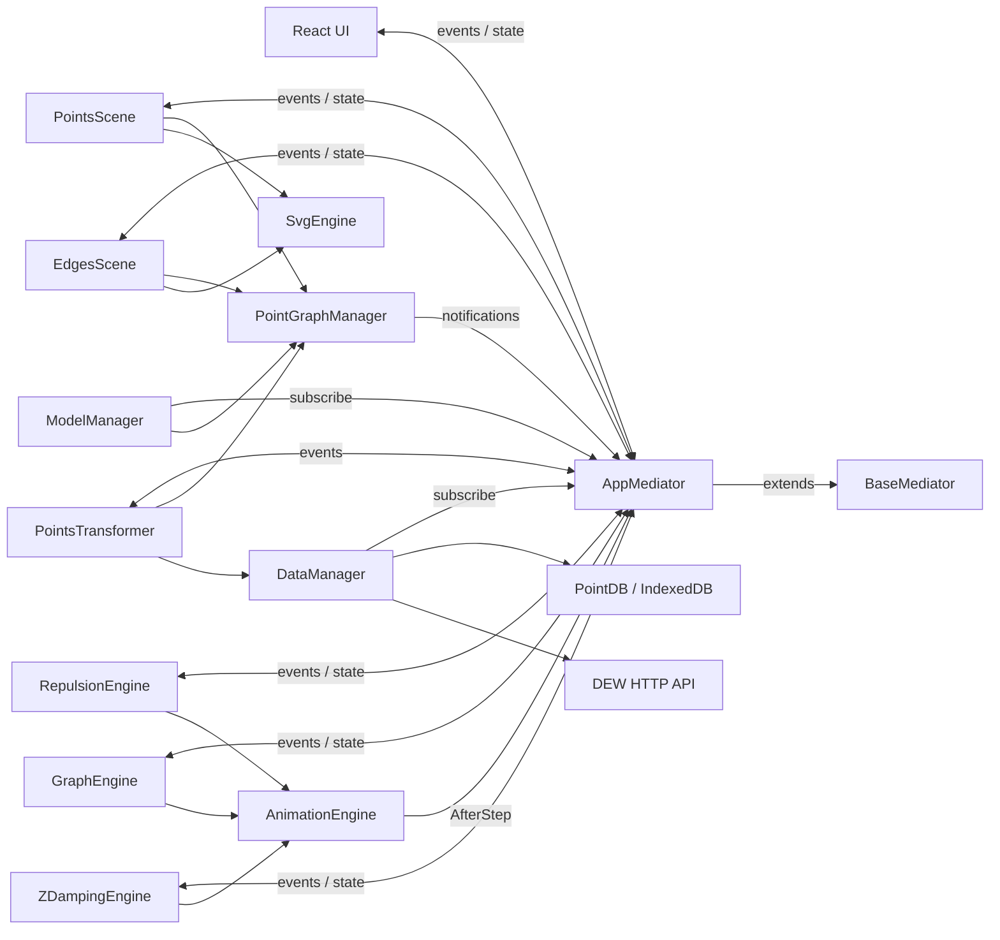
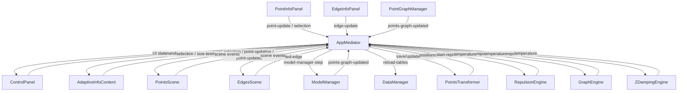

# AppMediator — карта событий и связей

> Снимок архитектуры клиентского пакета по ветке `dev`. Документ фиксирует фактические связи `AppMediator` с классами и системами, направление событий, payload и обнаруженных producers/consumers.

## Общая схема



`AppMediator` не содержит бизнес-логику: он является общей точкой обмена состоянием и событийными сигналами между UI, сценами, графом, физикой, сохранением и загрузкой.

Иерархия: `AppMediator → BaseMediator → EventTarget`.

## Полный список event names

| Событие | Payload | API публикации | Назначение |
|---|---|---|---|
| `progress` | `number` | `progress = value` | Прогресс операции |
| `target-size` | `number` | `targetSize = value` | Целевой размер |
| `temperature` | `number` | `temperature = value` | Состояние физической оптимизации |
| `size-text` | `number` | `sizeText = value` | Размер текста точек |
| `auto-zoom` | `boolean` | `autoZoom = value` | Автомасштабирование сцены |
| `selected-point` | `UIPoint \| null` | setter / `selectPoint()` | Выбранная точка |
| `selected-edge` | `UIEdge \| null` | setter | Выбранное ребро |
| `point-update` | `{ pointId, changes }` | `pointChange()` | Запрос изменения точки |
| `point-updated` | `{ pointId }` | `pointUpdated()` | Точка уже изменена |
| `edge-update` | `{ edgeId, changes }` | `updateEdge()` | Запрос изменения ребра |
| `clear-points` | — | `clearPoints()` | Команда очистки |
| `add-point` | — | `addPoint()` | Команда добавления |
| `start-repulsion` | — | `startRepulsion()` | Запуск физики |
| `start-graph` | — | `startGraph()` | Команда запуска Graph |
| `reload-tables` | — | `reloadTables()` | Перезагрузка данных |
| `points-updating` | — | `pointsUpdating()` | Частое обновление позиций |
| `points-updated` | — | `pointsUpdated()` | Завершение обновления |
| `points-graph-updated` | — | `pointsGraphUpdated()` | Изменился набор точек/рёбер |
| `model-manager-step` | — | `modelManagerStep()` | Шаг/переключение оптимизации |
| `save-positions` | — | `savePositions()` | Сохранение сцены |
| `positions-saved` | — | `positionsSaved()` | Сохранение завершено |
| `point-updating` | `{ pointId }` | `pointUpdating()` | Частое событие drag |

## Событийная диаграмма



## Связи по классам

### PointsScene

Подписки:

- `points-graph-updated` → синхронизация DOM;
- `selected-point` → обработка выбора;
- `point-update` → изменение `PointModel`;
- `points-updating` → обновление позиций;
- `size-text` → обновление размера текста;
- `auto-zoom` → `fitView()`.

Публикует:

- `selected-point` при клике;
- `point-updating` во время drag;
- `point-updated` после drag;
- `point-updated` после обработки `point-update`.

Напрямую использует `PointGraphManager` и `SvgEngine`.

### EdgesScene

Подписки:

- `selected-point` → подсветка инцидентных рёбер;
- `points-graph-updated` → перерисовка;
- `points-updating`, `points-updated`, `point-updated`, `point-updating` → обновление линий.

Публикует `selected-edge` при клике по ребру.

Напрямую использует `PointGraphManager` и `SvgEngine`.

### PointGraphManager

Публикует `points-graph-updated` после `update()` и удаления точек. Он является источником истины для текущих `PointModel` и `EdgeModel`.

### ModelManager

Подписывается на `model-manager-step` и переключает оптимизацию.

При изменении графа публикует `points-graph-updated`.

Напрямую использует `PointGraphManager` и `AnimationEngine`.

### PointsTransformer

Подписывается на:

- `points-updated` → сохраняет все точки;
- `point-updated` → сохраняет изменённую точку;
- `save-positions` → сохраняет точки и рёбра.

После сохранения сцены публикует `positions-saved`.

Таблицы получает от `DataManager` **напрямую**; большие массивы через медиатор не передаются.

### DataManager

Подписывается на `reload-tables`.

Напрямую работает с `PointDB`, `DocumentsApi`, `EmbeddingsApi` и `PointsTransformer`.

Поток загрузки:

```
DataManager
  -> PointDB / HTTP API
  -> PointsTransformer.setTables(...)
  -> PointGraphManager.update(...)
  -> AppMediator.pointsGraphUpdated()
```

### Physics

`RepulsionEngine`, `GraphEngine` и `ZDampingEngine` подписаны на общий `start-repulsion`.

Все используют `AnimationEngine` и через setter `mediator.temperature` публикуют `temperature`.

В bootstrap задано:

```
animationEngine.AfterStep = () => mediator.pointsUpdating();
```

Поэтому animation frame приводит к цепочке:

`AnimationEngine → AppMediator.pointsUpdating() → PointsScene / EdgesScene`.

## UI

### ControlPanel

Использует медиатор как командный интерфейс:

- `addPoint()`
- `clearPoints()`
- `startRepulsion()`
- `startGraph()`
- `savePositions()`
- `modelManagerStep()`

Читает/изменяет:

- `temperature`
- `progress`
- `targetSize`
- `autoZoom`

Слушает `positions-saved`.

Вычисление эмбеддингов вызывает напрямую через `ActionsApi`, минуя медиатор.

### AdaptiveInfoContent

Слушает `selected-point`, `selected-edge`, `size-text` и передаёт медиатор дочерним `PointInfoPanel` и `EdgeInfoPanel`.

### PointInfoPanel

Публикует `point-update` при изменении текста/pinned. При выходе изменяет `selectedPoint` и `selectedEdge`.

### EdgeInfoPanel

Публикует `edge-update` при изменении видимости.

## Наблюдаемые потоки

### Изменение точки

```
PointInfoPanel
  -> AppMediator.point-update
  -> PointsScene
  -> PointModel
  -> AppMediator.point-updated
  -> PointsTransformer
  -> DataManager
  -> PointDB
```

### Drag

```
PointsScene
  -> AppMediator.point-updating     (часто)
  -> EdgesScene

PointsScene
  -> AppMediator.point-updated      (после drag)
  -> PointsTransformer / EdgesScene
```

### Перестроение графа

```
ControlPanel
  -> AppMediator.model-manager-step
  -> ModelManager
  -> PointGraphManager
  -> AppMediator.points-graph-updated
  -> PointsScene / EdgesScene
```

### Физика

```
ControlPanel
  -> AppMediator.start-repulsion
  -> RepulsionEngine / GraphEngine / ZDampingEngine
  -> AnimationEngine
  -> AppMediator.points-updating
  -> PointsScene / EdgesScene
```

### Сохранение

```
ControlPanel
  -> AppMediator.save-positions
  -> PointsTransformer
  -> DataManager
  -> PointDB
  -> AppMediator.positions-saved
  -> ControlPanel
```

## События без обнаруженного consumer

По исходникам ветки `dev` в просмотренных классах не найден обработчик:

| Событие | Наблюдаемая публикация | Consumer |
|---|---|---|
| `add-point` | `ControlPanel` | не обнаружен |
| `clear-points` | `ControlPanel` | не обнаружен |
| `start-graph` | `ControlPanel` | не обнаружен |
| `edge-update` | `EdgeInfoPanel` | не обнаружен |
| `target-size` | setter / bootstrap | явный consumer не обнаружен |
| `progress` | setter | явный producer кроме самого состояния не обнаружен |
| `points-updated` | API медиатора | producer не обнаружен |

Это означает только отсутствие связи, обнаруженной при анализе исходников `dev`; не утверждается отсутствие динамического/косвенного использования.

## AppEventMap

`AppEventMap` не является полным реестром событий. В нём отсутствуют типы для:

- `SIZE_TEXT`;
- `START_GRAPH`;
- `RELOAD_TABLES`;
- `SAVE_POSITIONS`;
- `POSITIONS_SAVED`;
- `POINT_UPDATING`.

Следовательно, фактический API `AppMediator` шире, чем его текущая типовая карта.

## Границы ответственности

| Система | Роль |
|---|---|
| `AppMediator` | Координация состояния и сигналов |
| `BaseMediator` | EventTarget + state map |
| React UI | Команды пользователя и отображение состояния |
| `PointsScene` | Представление точек и point interaction |
| `EdgesScene` | Представление рёбер и выбор ребра |
| `PointGraphManager` | Источник истины для точек/графа |
| `ModelManager` | Оптимизация графа |
| `PointsTransformer` | Model/table преобразование и сохранение |
| `DataManager` | DB/API синхронизация |
| Physics engines | Изменение положения точек |
| `AnimationEngine` | Планирование animation callbacks |
| `SvgEngine` | SVG, zoom и drag |

### Ключевой вывод

Медиатор используется как **шина небольших событий и UI-состояния**, а не как транспорт данных. Точки, embeddings и рёбра передаются между `DataManager`, `PointsTransformer` и `PointGraphManager` напрямую; медиатор сообщает заинтересованным системам, что состояние изменилось.
