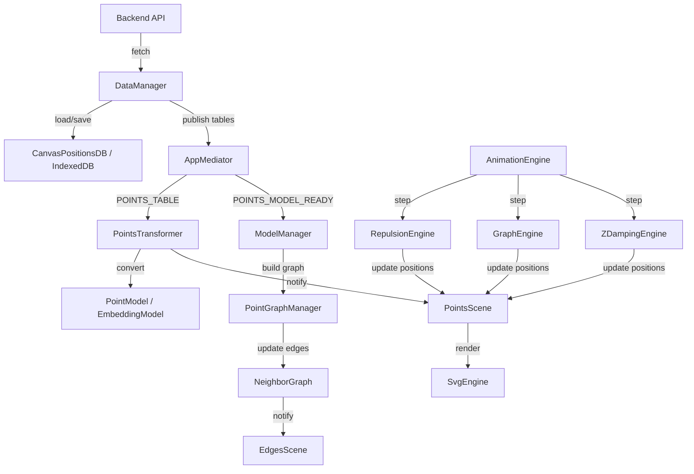

# Client Package

Пакет клиентского приложения для визуализации графов точек и их эмбеддингов.

## Структура исходного кода

```
src/
├── core/           # Ядро приложения (логика, модели, физика)
├── ui/             # UI компоненты (панели управления, информационные панели)
├── clients/        # API клиенты для взаимодействия с бэкендом
├── styles/         # Стили приложения
├── index.ts        # Точка входа приложения
└── global.d.ts     # Глобальные типы TypeScript
```

---

## Архитектура ядра (`core/`)

Ядро приложения разделено на следующие модули:

### 1. Менеджеры и Координаторы

| Класс | Описание |
|-------|----------|
| `AppMediator` | Центральный посредник (mediator) приложения. Управляет событиями между компонентами: точки, рёбра, выбор элементов, зум, температура симуляции. Определяет карту событий `AppEventMap`. |
| `BaseMediator` | Базовый класс для медиаторов. Реализует паттерн Observer через `EventTarget`, предоставляет методы `set/get/has` для состояния и `emit` для событий. |
| `ModelManager` | Строит и улучшает граф ближайших соседей. Вычисляет среднее косинусное расстояние по всем общим моделям эмбеддингов. Работает напрямую с `PointModel.embeddings` без кэширования векторов. |
| `PointGraphManager` | Инкапсулирует управление коллекцией точек (`EntityCollection<PointModel>`) и графом связей (`NeighborGraph`). Гарантирует консистентность: при изменении точек автоматически очищает "висячие" рёбра. |
| `PointsTransformer` | Преобразует данные из таблиц базы данных (`PointTable`, `EmbeddingTable`, `EdgeTable`) в модели (`PointModel`, `EmbeddingModel`, `EdgeRefs`). Синхронизирует состояние между `DataManager` и `PointsScene`. |
| `DataManager` | Управляет IndexedDB базой данных (`CanvasPositionsDB`) и API клиентами (`DocumentsApi`, `EmbeddingsApi`). Загружает и сохраняет точки, эмбеддинги и рёбра. Подписывается на команду перезагрузки таблиц. |

---

### 2. Модели данных

#### Основные модели

| Класс/Интерфейс | Описание |
|-----------------|----------|
| `PointModel` | Расширяет `Point` (x, y, z). Содержит `id`, `text`, флаги `dragged`, `selected`, `pinned`. Владеет коллекцией `embeddings: Map<string, EmbeddingModel>`. Свойство `fixed` возвращает `true`, если точка зафиксирована. |
| `EmbeddingModel` | Модель эмбеддинга документа. Содержит `docid`, `modelName`, вектор `value[]`, метаданные. Вычисляет `activeIndices` — знаковые индексы активных размерностей (положительные/отрицательные значения выше порога). Предоставляет методы для подсчёта пересечений с другими эмбеддингами. |
| `EdgeModel` | Модель ребра графа. Реализует интерфейсы `Edge` и `EdgeRef`. Содержит ссылки на `source` и `target` (`PointModel`), вычисляет `intersectionSet` (общие активные индексы), `intersectionCount`, `color` на основе паттерна. |
| `Point` | Базовый класс точки с координатами (x, y, z). Предоставляет методы мутации: `set`, `add`, `sub`, `scale`, `normalize` и статические аналоги. |
| `PointMath` | Интерфейс для математических операций с точками (2D или 3D). |

#### Вспомогательные модели

| Класс/Интерфейс | Описание |
|-----------------|----------|
| `Edge` | Интерфейс ребра: `source: PointModel`, `target: PointModel`. |
| `EdgeRef` | Интерфейс ссылки на ребро: `sourceId`, `targetId`, `modelName?`, `distance?`. |
| `EdgeRefs` | Тип-массив ссылок на рёбра: `EdgeRef[]`. |
| `EdgeIndex` | Интерфейс индекса ребра: `sourceIndex`, `targetIndex` (используется в алгоритме триангуляции). |
| `UIPoint` | UI-представление точки: `id`, `x`, `y`, `z`, `text`, `fixed`. |
| `UIEdge` | UI-представление ребра: `id`, `sourceId`, `targetId`, `distance?`, `visible`. |

---

### 3. Коллекции и Графы

| Класс | Описание |
|-------|----------|
| `EntityCollection<T>` | Универсальная коллекция сущностей с индексацией по ID. Хранит массив `items` и `indexMap: Map<string, number>` для быстрого доступа. Предоставляет методы `getById`, `add`, `_setPoints` (пакетное обновление с разделением на вставку/обновление). |
| `NeighborGraph` | Единое хранилище графа связей и плоского списка рёбер. Использует `adjacency: Map<string, Set<string>>` для представления смежности. Обеспечивает консистентность: при добавлении ребра модель добавляется в оба направления. При обнаружении несимметричности выдаётся предупреждение. |
| `Delaunay` | Реализация алгоритма триангуляции Делоне. Принимает массив точек `PointMath2d[]`, возвращает уникальные рёбра `EdgeIndex[]`. Использует супер-треугольник, находит "плохие" треугольники, строит границу и обновляет триангуляцию. |

---

### 4. Физические движки

| Класс | Описание |
|-------|----------|
| `RepulsionEngine` | Движок отталкивания точек. Использует закон обратных квадратов для вычисления сил отталкивания между всеми парами точек. Поддерживает температуру симуляции, останавливается при достижении `stopTemperature`. |
| `GraphEngine` | Движок притяжения связанных точек (рёбер графа). Применяет силу пружины к связанным точкам, стремясь к `targetDistance`. Работает в цикле анимации. |
| `ZDampingEngine` | Движок затухания по оси Z. Применяет демпфирование к координате Z точек, стабилизируя вертикальное положение. Использует `dampingFactor` (например, 0.999) для постепенного уменьшения Z. |

---

### 5. Движки рендеринга и анимации

| Класс | Описание |
|-------|----------|
| `AnimationEngine` | Управление циклом анимации через `requestAnimationFrame`. Поддерживает очередь колбэков (`Set<AnimationCallback>`), автоматический старт/остановку при добавлении/удалении колбэков. Предоставляет хуки `AfterStep` и `onStop`. |
| `SvgEngine` | Универсальный движок для работы с SVG-холстом. Управляет SVG, zoom/pan (через d3-zoom), координатами. Поддерживает перетаскивание элементов через единый предикат (определяется сценой). Zoom автоматически отключается на элементах, для которых `dragPredicate` возвращает `true`. |
| `PointsScene` | Сцена для отрисовки точек. Создаёт SVG-группу, управляет коллекцией `PointModel[]` и `EdgeModel[]`. Регистрирует детектор перетаскивания, обрабатывает клики, подписывается на события медиатора. Синхронизирует UI с состоянием `PointGraphManager`. |
| `EdgesScene` | Сцена для отрисовки рёбер графа. Отображает линии между точками на основе `EdgeModel[]`. Подписывается на обновления рёбер и позиций точек, перерисовывает линии при перемещении точек. |

---

### 6. Утилиты и помощники

| Класс | Описание |
|-------|----------|
| `ActiveDimensionsBuilder` | Вычисляет порог активации размерностей для эмбеддингов. Может использовать фиксированный порог или адаптивно вычислять его на основе распределения значений (целевая доля активных размерностей). |
| `PatternMatcher` | Сопоставитель паттернов для эмбеддингов. Вычисляет `patternScore` (количество общих активных индексов) и определяет цвет пары через `PatternColorPalette`. |
| `PatternColorPalette` | Палитра цветов для визуализации паттернов пересечения. Генерирует цвет на основе хэша отсортированного множества активных индексов. |

---

### 7. Работа с данными (IndexedDB)

#### Менеджер и хранилище

| Класс | Описание |
|-------|----------|
| `CanvasPositionsDB` | Расширяет `Database`. Определяет таблицы IndexedDB: `points`, `embeddings`, `edges`. Настраивает индексы для каждой таблицы (по дате обновления, заголовку и т.д.). |
| `DataManager` | (см. раздел 1) |

#### Таблицы данных

| Интерфейс | Описание |
|-----------|----------|
| `PointTable` | Структура точки в БД: `id`, `x`, `y`, `z`, `title`, `updated_at`. |
| `EmbeddingTable` | Структура эмбеддинга в БД: `session_id`, `model_name`, `value[]`, `created_at`, `processingTimeMs`. |
| `EdgeTable` | Структура ребра в БД: `id`, `source_id`, `target_id`, `model_name?`, `distance?`, `updated_at`. |

#### Базовые классы IndexedDB

| Класс/Интерфейс | Описание |
|-----------------|----------|
| `Database` | Абстрактный базовый класс для работы с IndexedDB. Управляет подключением к БД, регистрирует таблицы, предоставляет методы для транзакций. |
| `Table<T, TKey>` | Реализация таблицы IndexedDB. Предоставляет CRUD-операции через конфигурацию `TableConfig`. |
| `ITable<T, TKey>` | Интерфейс таблицы: методы `get`, `put`, `delete`, `query`, `forEach`. |
| `IIndex` | Интерфейс индекса таблицы. |
| `TableConfig` | Конфигурация таблицы: имя, ключевое поле, индексы. |

---

### 8. Интерфейсы

| Интерфейс | Описание |
|-----------|----------|
| `IEdgeModelFactory` | Фабрика для создания `EdgeModel` из `EdgeRef`. Используется `NeighborGraph` для ленивого создания моделей рёбер. |

---

### 9. Тестирование

| Класс | Описание |
|-------|----------|
| `PointsSceneTester` | Тестовый класс для симуляции изменений сцены. Позволяет настраивать процент обновляемых точек, количество новых точек, интервал между итерациями. Используется для отладки производительности и стабильности визуализации. |

---

## Поток данных



---

## Основные события (AppMediator)

| Событие | Payload | Описание |
|---------|---------|----------|
| `PROGRESS` | `number` | Прогресс загрузки/обработки |
| `TARGET_SIZE` | `number` | Целевое количество точек |
| `TEMPERATURE` | `number` | Температура физической симуляции |
| `AUTO_ZOOM` | `boolean` | Режим авто-зума |
| `SELECTED_POINT` | `UIPoint \| null` | Выбранная точка |
| `SELECTED_EDGE` | `UIEdge \| null` | Выбранное ребро |
| `POINT_UPDATED` | `{ pointId, changes }` | Обновление параметров точки |
| `EDGE_UPDATE` | `{ edgeId, changes }` | Обновление параметров ребра |
| `EDGES_TABLE` | `EdgeTable[]` | Данные таблицы рёбер |
| `POINTS_MODEL_READY` | `{ points, edges }` | Модели точек и рёбер готовы |
| `START_REPULSION` | — | Запуск физической симуляции |
| `RELOAD_TABLES` | — | Команда перезагрузки таблиц из БД |

---

## Зависимости

- **d3** — визуализация, zoom/pan, drag-and-drop
- **IndexedDB** — локальное хранение данных
- **TypeScript** — строгая типизация

---

## Быстрый старт

```bash
cd packages/client
npm install
npm run dev
```

Приложение запустится на `http://localhost:5173` (или другой порт, указанный в выводе Vite).
